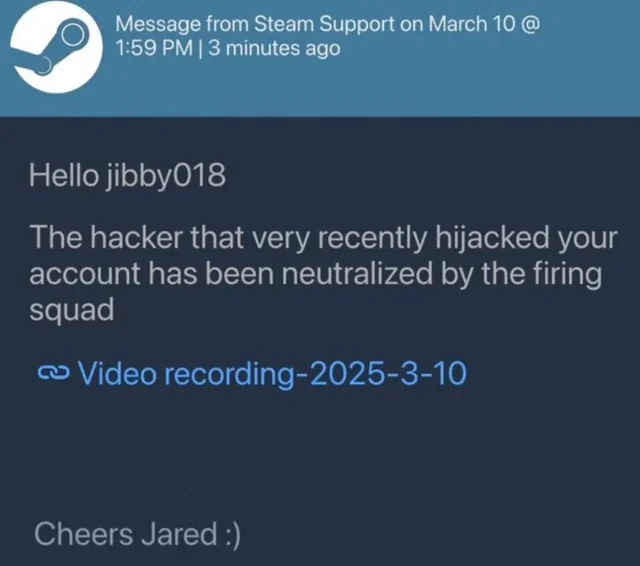

After updating my Steam Deck to the latest version of SteamOS, I ran into a weird issue. On restart, the Steam Deck tried to finish the update, but started it all over again and failed, resulting in a restart loop. Valve is great at supporting its hardware and software (you've definitely seen the memes about how they get your Steam account back), but this time, even the OS version from before the update had the same problem.

At first, I thought it was a connection issue. I tried multiple VPNs and checked my OpenWRT router setup again, but no luck. Then I found this GitHub issue in the `steam-for-linux` repo:



At least now I knew it wasn't just me; other people had the same problem. I also found a workaround: I got into Desktop Mode and made it the default. It worked, but it was a bit janky and not the best way to use the device. Then a new Steam Deck update came out that specifically mentioned a fix for a startup bug in the launcher, and I thought the problem was finally solved. I downloaded the update, but it didn't fix my problem.

After about a month, and a bit frustrated, I remembered that the Steam Deck is just a Linux device and I had already turned on SSH. So I thought: let's give Claude Code a try and ask it to SSH into the device and see what's going on. I used Opus 5.5 at the `high` effort level, and in about 20 minutes (mostly spent waiting for the device to shut down and boot up again), the problem was found and fixed. The first moment I could log into Game Mode again was a thrill.

The main issue was apparently a new SteamOS feature that backs up the `.steam` directory (if it exists) before updating. I had that directory, but it was empty. Based on my checks, that broke and reset the update registry, so the update got stuck: it was fully downloaded, but its registry entry was never updated. This caused the restart loop, and the fix was to remove that directory. I did that, and boom: we were in Game Mode with no issues.

During the debugging, Claude wrote `systemd` services, checked logs, and restarted the device to reproduce the problem and catch it in the act. It was interesting to watch Claude investigate my device through all those shutdowns and reboots. I also [reported my findings in the issue](https://github.com/ValveSoftware/steam-for-linux/issues/13732#issuecomment-6563430311), hoping they'd help other people in the thread. Surprisingly, three people had the same issue, and the fix solved their problem, too.

To me, that's one of the benefits of AI. Without it, I would have spent a week on a random issue caused by an update and probably still not solved it. Honestly, I wouldn't even have started, because it looked too complex. Plus, the fix helped other people, too.

So, in the end: we like AI on this blog, but we try to learn from it, not follow it blindly :)
